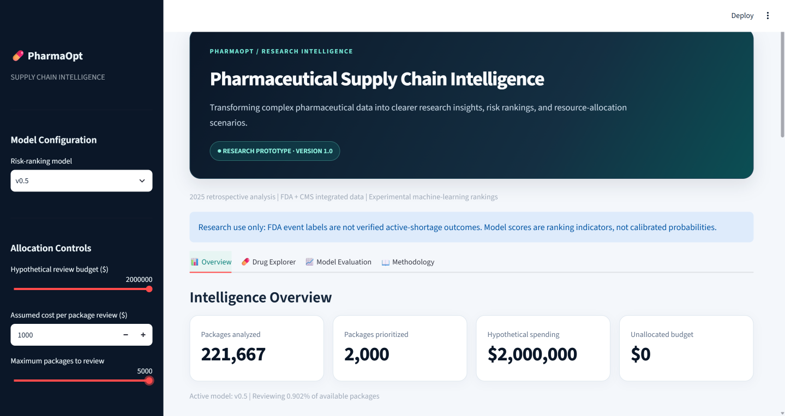

# PharmaOpt 💊

### Making pharmaceutical supply-chain data easier to explore and understand

**An independent data analytics project by Joaquin Pizano | University of South Florida**

[**Explore the Live Dashboard**](https://pharmaopt.streamlit.app/) · [**View the Code**](https://github.com/joaquinpizano/pharmaopt)



## The problem

Pharmaceutical supply chains involve thousands of products and complicated information from different sources. When a team has limited time or resources, **which products should it look at first?**

PharmaOpt explores how data can help organize that question. It combines public information from the U.S. Food and Drug Administration (FDA) and Medicare to rank pharmaceutical packages for further investigation, compare different analytical approaches, and demonstrate how a fixed review budget could be used.

**This is a research and portfolio project—not a system that confirms current drug shortages or recommends medical or purchasing decisions.**

## What can you do with PharmaOpt?

[**Try the interactive dashboard →**](https://pharmaopt.streamlit.app/)

The dashboard has four sections:

| Section | What you'll find |
|---|---|
| **Overview** | See how many packages were analyzed, which packages rank highest for follow-up, and how a sample budget changes the number selected. |
| **Drug Explorer** | Search the selected packages by drug name, brand, company listed with the FDA, or National Drug Code (NDC). |
| **Model Evaluation** | Compare two approaches and see how many packages associated with recorded FDA events appeared near the top of each ranking. |
| **Methodology** | Learn where the data came from, how the analysis works, and what the results cannot tell us. |

**Suggested starting point:** Open **Overview** and adjust the review budget in the sidebar. Then visit **Model Evaluation** and select **All FDA-linked events** to see the main historical comparison.

## Project at a glance

| Measure | Result |
|---|---:|
| Historical package-year records analyzed (2022–2025) | **762,907** |
| Pharmaceutical package records in the 2025 dashboard | **221,667** |
| Models compared | **2** |
| FDA-linked event flags in the 2025 comparison | **96** |
| Public interactive dashboard | **Live** |

A *package-year* means a pharmaceutical package represented in a particular year. It is not the same as a unique drug or a patient.

## What did I find?

I compared two experimental models that rank pharmaceutical packages using historical data:

- **v0.4 — the simpler model:** Uses historical FDA-related signals and Medicare utilization information.
- **v0.5 — the expanded model:** Adds information extracted from the language used in FDA recall reports.

In the **2025 retrospective development evaluation**, the simpler model performed better on the main FDA-linked event measure.

| 2025 comparison | v0.4 | v0.5 |
|---|---:|---:|
| FDA-linked events among the top 500 ranked packages | **10 of 96** | **7 of 96** |
| Precision–recall area under the curve (PR-AUC) | 0.003897 | 0.002858 |

**What that means:** If a team could investigate only 500 of the 221,667 listed packages, the v0.4 ranking placed more packages with the recorded FDA event label in that review group. This is a historical research result, **not evidence that the model predicts real-world shortages reliably**.

The additional recall-language features did not improve the main comparison in this experiment. The models also used different training solvers, so the result cannot be attributed to the added features alone.

**Important context:** The 96 FDA-linked flags include **84 discontinuation-notice candidates** and **12 non-discontinuation-event candidates**. They are **not 96 independently verified active shortages**. The 2025 dataset was reviewed repeatedly during development, so it is **not an untouched final test**.

## How I built it

This project brings together several areas of analytics:

1. **Collect and organize data:** Combined FDA drug product, package, shortage, and recall records with available Medicare Part D information.
2. **Check data quality:** Examined identifier matches, dates, missing information, and historical data availability. Unmatched product identifiers were not automatically forced into matches.
3. **Build and compare models:** Trained experimental ranking models on 2022–2024 records and compared their rankings against 2025 FDA-linked event indicators.
4. **Analyze written recall reports:** Used natural language processing (NLP) to categorize recall descriptions and explore whether that information improved rankings.
5. **Explore resource decisions:** Built hypothetical allocation studies to show how limited resources could be distributed under stated assumptions.
6. **Build a dashboard:** Created and deployed an interactive application using Streamlit and Plotly.

### Data sources

- **FDA National Drug Code Directory:** Pharmaceutical product, package, and listing information.
- **FDA Drug Shortage records:** Historical FDA-linked event information used in research labels and features.
- **FDA Drug Enforcement / Recall reports:** Recall histories and text descriptions.
- **CMS Medicare Part D:** Historical prescription utilization and spending information for matched records.

*Medicare Part D data captures only part of pharmaceutical use and is not a measure of total U.S. drug demand. Historical source availability is not fully verified.*

### Additional research

**Understanding recall descriptions:** A rule-based recall-language classification system categorized **97.61% of 17,975 recall records** in an earlier research dataset. This measures categorization coverage, not verified shortage prediction.

**Resource allocation case study:** A separate simulated study of lisdexamfetamine allocation used OR-Tools to compare strategies under specified constraints. One balanced approach reduced the study's **modeled demand-weighted unmet-demand objective by 14.87%** relative to proportional allocation. This is a simulation result—not an observed improvement in drug availability or patient outcomes.

## Tools and technical skills

| Area | Tools and methods |
|---|---|
| Data preparation and analysis | Python, pandas, SQL, MySQL, Jupyter |
| Machine learning | scikit-learn, rare-event ranking, model evaluation |
| Text analysis | NLP, rule-based classification, TF-IDF |
| Optimization | Google OR-Tools, constrained scenario analysis |
| Visualization and publishing | Streamlit, Plotly, GitHub |

## Project files

```text
pharmaopt/
├── README.md
├── pharmaopt_dashboard.py
├── pharmaopt_2025_dashboard_corrected_v01.csv.gz
├── pharmaopt_2025_dashboard_enriched_v01 (1).csv.gz  # older dataset
├── requirements.txt
├── dashboard-overview.png
├── docs/
├── notebooks/
└── sql/
```

The published app reads **`pharmaopt_2025_dashboard_corrected_v01.csv.gz`**. The older compressed file is retained in the repository but is not the active dashboard source. The public repository contains a selected subset of the research workflow, not every local dataset or experiment.

### Run the published dashboard locally

With Python installed, from the cloned repository:

```bash
python -m pip install -r requirements.txt
python -m streamlit run pharmaopt_dashboard.py
```

The included compressed dashboard dataset supports the public-facing dashboard. Fully rebuilding the research models requires additional source data and notebook workflows and is **not** presented here as a one-command reproduction.

## Important limitations

PharmaOpt is an **educational research prototype**. In particular:

- **FDA events are not confirmed active shortages.** Recorded shortage-related events and discontinuation notices may have different meanings and may change retrospectively.
- **The model scores are rankings, not probabilities.** A high score does not mean a product has a known percentage chance of becoming unavailable.
- **2025 is a development evaluation.** It was examined during model development and does not provide independent prospective validation.
- **Event labels are rare.** Small numbers of recorded events make model comparisons uncertain.
- **Data timing and matching have limitations.** Some historical publication timing, product matching, and missing fields require further validation.
- **Review budgets and allocation results are hypothetical.** No clinical benefit, shortage prevention, purchasing improvement, or financial savings have been demonstrated.

**Do not use PharmaOpt for clinical care, live shortage prediction, automated purchasing, or actual inventory allocation.**

## About the developer

**Joaquin Pizano**  
University of South Florida · B.S. Artificial Intelligence & Business Analytics

I built PharmaOpt independently to practice solving a real-world business problem through data engineering, research, machine learning, and interactive analytics. My goal is to make complicated information easier for people to explore and use thoughtfully.

[Live Dashboard](https://pharmaopt.streamlit.app/) · [GitHub Profile](https://github.com/joaquinpizano) · [LinkedIn](https://www.linkedin.com/in/joaquinpizano/)  
Contact: joaquinpizano@usf.edu

---

*Independent student research project. Not affiliated with or endorsed by the FDA, CMS, or the University of South Florida.*
